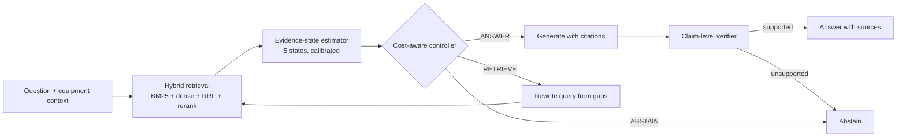

<div align="center">

# UACT-RAG

**Uncertainty-Aware Cognitive Triage for Retrieval-Augmented Generation**

Know when to answer, when to retrieve more, and when to abstain, for trustworthy question answering over engineering documentation.


</div>

---

## Overview

Retrieval-augmented generation can still produce fluent answers from incomplete, mismatched or conflicting evidence, which is risky for maintenance and troubleshooting advice. UACT-RAG adds a decision layer on top of a hybrid retriever:

1. **Estimate the evidence state.** A lightweight, calibrated model classifies the retrieved passages as *sufficient*, *partial*, *irrelevant*, *missing* or *contradictory*, using relevance, coverage, contradiction and source-agreement features.
2. **Choose an action.** A cost-sensitive policy, trained on measured action utilities, picks **ANSWER**, **RETRIEVE** or **ABSTAIN** under a retrieval budget.
3. **Verify the answer.** A claim-level verifier checks each statement against its cited passages, and the system abstains if support is missing.



> **Status.** This is research code. The CPU smoke test checks wiring only, and no experimental results are included. Every number you report must come from your own logged runs on a frozen test split.

## Features

- Hybrid retrieval with BM25 (`bm25s`), BGE-M3 dense search (FAISS), reciprocal rank fusion and a cross-encoder reranker
- Five-state evidence estimator with temperature scaling, plus a three-state variant for ablation
- Learned cost-sensitive controller with an abstention margin, and fixed-rule controllers for comparison
- Baselines B0-B9 and ablations A1-A7 under one interface
- Metrics: ECE, Brier, NLL, selective risk, coverage, AURC / E-AURC, paired bootstrap, McNemar, Holm correction
- Leakage-aware splits and a train / val / cal / test protocol, with tuning on validation only

## Quick start

```bash
git clone https://github.com/Akramtaha98/UACT-RAG.git
cd UACT-RAG
python -m venv .venv && source .venv/bin/activate
pip install -U pip
pip install -r requirements.txt
python tests/smoke_test.py          # CPU only, no downloads; should print SMOKE TEST PASSED
```

Tips:

- `vllm` pins its own `torch` build. If pip reports a conflict, install `vllm` first, then the rest.
- Generation runs on vLLM, so a CUDA GPU with 80 GB or more is recommended when the generator, embedder, reranker and NLI model share one device. Adjust `models.vllm_gpu_mem_util` in `configs/default.yaml`.
- Use `faiss-gpu` instead of `faiss-cpu` only if it matches your CUDA build.
- For long runs, use `tmux` or `nohup bash run_all.sh data/techqa > run.log 2>&1 &`.
- Gated models (for example Llama) need `huggingface-cli login`. The default generator, Qwen3-8B, does not.

## Data

Datasets are not included and must be obtained under their own licences.

```bash
# RAGBench (check the dataset id, split names and fields on its Hugging Face card)
python scripts/prepare_data.py ragbench --subsets emanual techqa

# IBM TechQA (registration required; file names vary by release, see the [ADJUST] lines in the script)
python scripts/prepare_data.py techqa --root /path/to/TechQA \
    --technotes /path/to/TechQA/training_dev_technotes.json --out data/techqa

# Your own engineering-manual collection (schema below)
python scripts/prepare_data.py engineering --questions my_questions.jsonl \
    --corpus my_passages.jsonl --out data/engineering
```

Build the indexes, then the evidence-state training data. Contradiction examples must be reviewed by a person:

```bash
python scripts/build_index.py --data data/techqa

python scripts/make_state_data.py candidates --subsets emanual techqa --n 600
#   a qualified reviewer sets "reviewed": true/false on each line of data/contradiction_candidates.jsonl
python scripts/make_state_data.py build --subsets emanual techqa
python scripts/make_state_data.py techqa_retrieved --data data/techqa
```

`--allow_unreviewed` exists for development only. Do not report results from a model trained on unreviewed contradictions.

<details>
<summary>Engineering collection record schema</summary>

```json
{
  "question_id": "ENG_001",
  "question": "What checks are required for abnormal pump vibration?",
  "equipment_model": "Model-A",
  "document_ids": ["manual_01", "manual_02"],
  "gold_evidence_ids": ["manual_01_p17"],
  "reference_answer": "<expert-verified answer>",
  "evidence_state": "sufficient",
  "answerable": true,
  "domain": "industrial_maintenance",
  "difficulty": "medium",
  "document_revision": "2025-01"
}
```

Corpus passages: `{"pid", "doc_id", "text", "revision", "equipment_model"}` per line. Splits are made by equipment family so revisions of one manual never straddle train and test.

</details>

## Run the pipeline

```bash
bash run_all.sh data/techqa
```

| Step | What happens |
| --- | --- |
| 1 | Train estimators: full, A1 (relevance-only features), A7 (three-state) |
| 2 | Roll out all feasible actions on train and val questions |
| 3 | Train and tune the controllers on validation rollouts |
| 4 | Fit baseline confidence models and thresholds on validation |
| 5 | Evaluate all systems on the frozen test split |
| 6 | Forced-answer runs for risk-coverage curves, batch-size-1 latency runs, retrieval-budget sweep |
| 7 | Produce tables, curves and paired statistics |

Outputs go to `runs/main/`:

- `*/estimator_report.json`: macro-F1, NLL, Brier, ECE, AUROC / AUPRC for insufficient-evidence detection, confusion matrix, baseline detectors
- `*/controller_grid.json`: every tuned grid point
- `eval/<dataset>_test/results_table.md`, `results_table.csv`, `risk_coverage.png`, `paired_stats.csv`, and per-question records (`*.jsonl`)

Each script has a docstring with its arguments. For quick iteration use `--split val --max_q 100`.

## Systems

| Id | System | Note |
| --- | --- | --- |
| B0 | No retrieval | |
| B1 | Standard RAG | dense top-k |
| B2 | Hybrid RAG | BM25 + dense + RRF + reranker |
| B3 | Adaptive-RAG-style | approximation: zero-shot router, not the trained classifier |
| B4 | CRAG-style | approximation: reranker-score evaluator, no web search |
| B5 | Self-RAG | not included; run the official repository on the same queries |
| B6 | Fixed RAG + calibrated abstention | threshold tuned on validation |
| B7 | Budget-matched multi-retrieval | always retrieves the maximum number of times |
| B8 | Calibrated-confidence controller | simple strong baseline, a reimplementation |
| B9 | Sufficiency-autorater abstention | LLM judge of context sufficiency |
| B10 | BeliefRAG-style | not included; no public code was found |
| UACT | Full method | |
| A1-A7 | Ablations | relevance-only features, fixed budget, no verifier, no abstention (offline only), fixed thresholds, no cost penalty, three-state estimator |

Baselines B0-B4 and B7 use the same generator prompt, which allows `INSUFFICIENT_EVIDENCE`, so they can abstain by prompting. State this in the paper.

## Repository layout

```
uact/
  retrieval.py     hybrid retrieval, RRF, reranking
  features.py      evidence features: relevance, coverage, contradiction, answerability
  estimator.py     five-state MLP + temperature scaling
  controller.py    per-action utility regressors, abstention margin, fixed-rule controllers
  verifier.py      claim-level NLI verifier
  systems.py       UACT-RAG, baselines, scoring
  metrics.py       calibration, selective prediction, paired statistics
  report.py        per-system summaries
scripts/           data prep, indexing, training, evaluation, analysis
configs/           default.yaml
tests/             CPU smoke test with stub models
run_all.sh         full pipeline
```

## Design notes

- **Splits.** Train fits models and builds controller targets. Val does early stopping and all tuning. Cal fits temperature scaling. Test is used once, by the final evaluation.
- **Controller targets.** ANSWER and ABSTAIN utilities are measured. RETRIEVE utilities use a reference continuation policy, which is an approximation and a stated limitation.
- **Selection rule.** Lambda, mu and the abstention margin are chosen to minimise mean cost subject to validation selective risk of at most `--risk_target` (default 0.10) and coverage of at least `--min_coverage` (default 0.50). Pre-register these values.
- **Risk-coverage curves and AURC** come from `--forced` runs, where every question is answered and ranked by the system's confidence.
- **Latency** is exact only with `--batch_size 1`; batched runs report time divided by batch size.
- **Correctness** uses an LLM judge or token-F1 (`eval.use_llm_judge`). Neither is ground truth, so validate on a human-audited subset.
- **Verifier.** DeBERTa-MNLI entailment of each claim against cited passages is an automated proxy, and it can fail when model memory agrees with a bad passage.

## Before you trust results

1. Check RAGBench dataset id, split names and field names, and the label-to-state rules in `make_state_data.py`.
2. Check TechQA file names and fields in `prepare_data.py` (lines marked `[ADJUST]`).
3. Confirm `bm25s` and `sentence-transformers` API behaviour for your installed versions.
4. Confirm the vLLM chat template for your generator.
5. Check model licences (the Llama 3.1 Community License has attribution and naming rules) and the licences of any manuals you include.

## Citation

A paper describing this work is in preparation. A citation entry will be added here once it is available.

## License

No licence has been chosen yet. Add a `LICENSE` file (for example MIT or Apache-2.0) before sharing the code more widely. Datasets and models keep their own licences.
